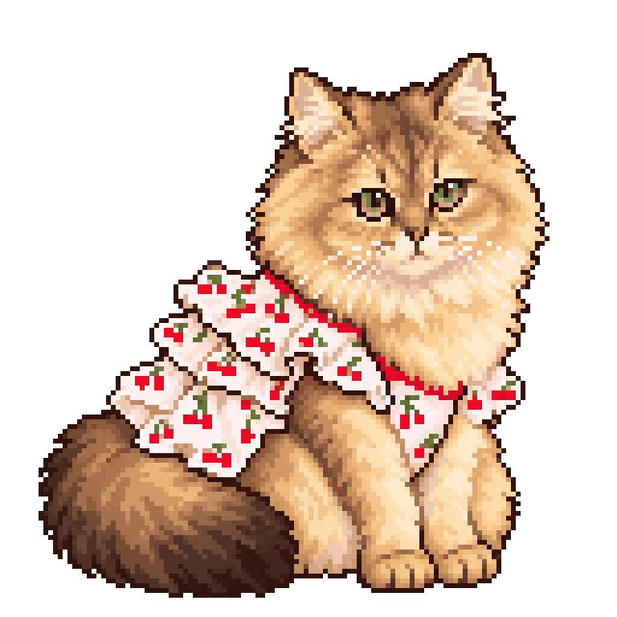
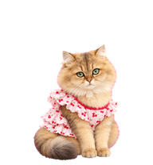
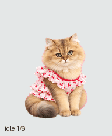
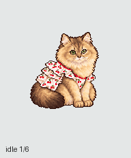
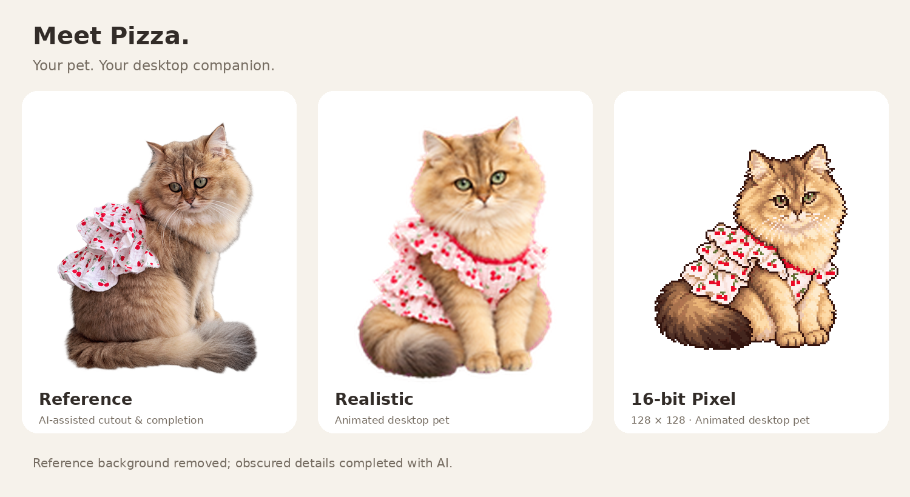

<a href="README.md">中文</a> | <strong>English</strong>

  

<h1 align="center">Pizza</h1>

Your pet. Your tiny on-screen supervisor.

Wish your pet could keep you company at your desk? Turn a few photos into a realistic or pixel companion for coding sessions, homework, and well-earned breaks. No pet of your own? Pizza is ready to move in.

  <a href="#preview">See both looks</a> ·
  <a href="#create">Make your own</a> ·
  <a href="#install">Get Pizza</a>

## Two looks, one Pizza

One Pizza has soft, realistic fur. The other is made of pixels, wearing the same cherry dress. Watch the previews below to see your tiny on-screen supervisor in action.

| Realistic Original | 16-bit Pixel |
| :---: | :---: |
|  |  |
| Soft fur, cherry dress | Pixel art, same cherry dress |
|  |  |

[View the native pixel portrait](previews/pizza-pixel-native.png)

## From pet photos to a tiny desktop supervisor

Pizza started with photos. We picked out the details that make her recognizable: her face, long golden fur, and cherry dress. Then we created realistic and pixel versions, checked that both still looked like her, and brought them to life with waves and jumps. Even in motion, she's still the same familiar cat.

  

**Reference (AI-assisted cutout and completion)** · [View reference](previews/pizza-reference-ai-assisted.png)

AI was used to remove the background and fill in obscured details in the reference photo. The comparison shows the reference, realistic Pizza, and pixel Pizza from left to right.

## Make one from your own pet

Choose a few photos that clearly show your pet's face, fur color, and markings. Send them to your AI along with the [creation prompt](prompts/create-your-pet.md#english), and tell it which details to keep. For example:

> Keep the face and ears recognizable, including the markings on the tail. Show me the realistic and pixel versions first, then make the animations.

Approve both main looks, then review the animation previews. Once you're happy with them, you'll get a separate install sheet for each version, ready to use in an app that supports Pets v2.

**[Open the creation prompt](prompts/create-your-pet.md#english)**

The full workflow lives in a separate file, ready to open, copy, and share.

## Bring Pizza home

Want to try it first? Send the [installation prompt](prompts/install.md#english) to your AI. It will check whether your app supports installation, then add both the realistic and pixel versions. Realistic Pizza takes the first shift, and your existing pets stay right where they are.

**[Open the installation prompt](prompts/install.md#english)**

Ready for a different look? Just say, “Switch to Pizza Pixel.”
