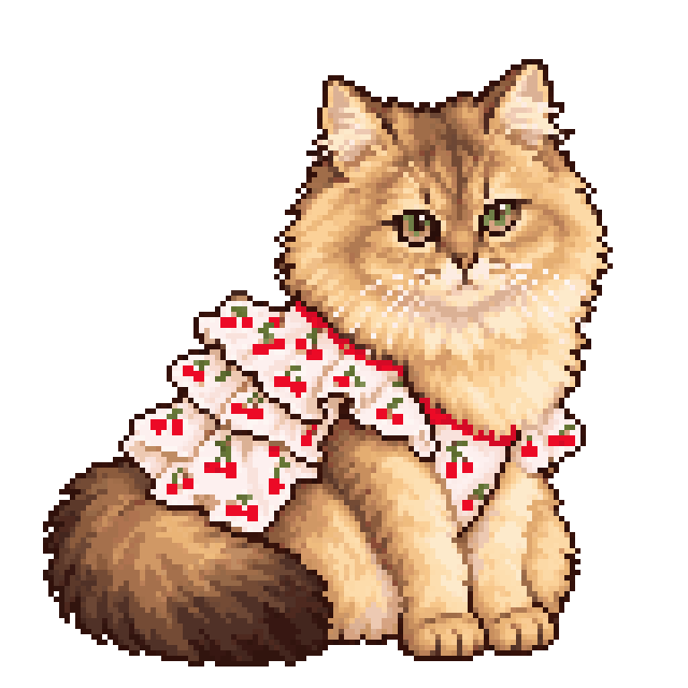
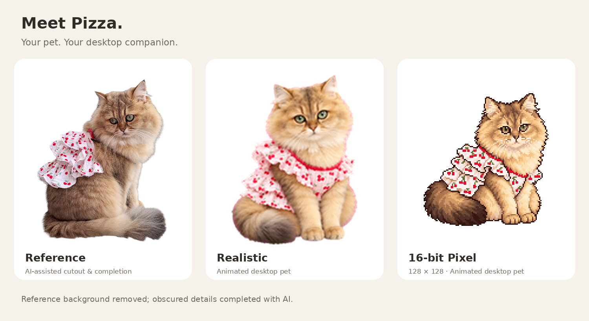
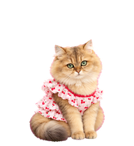
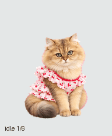
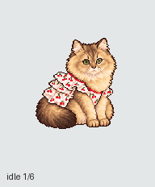

<p align="center"><strong>中文</strong> | <a href="README.en.md">English</a></p>

<p align="center">
  
</p>

<h1 align="center">披萨</h1>

<p align="center">让你家的毛孩子来屏幕里监工。</p>

想把你家的毛孩子搬进屏幕，当你的专属小监工吗？用几张照片，把它变成写实或像素模样，陪你写代码、赶作业、摸会儿鱼。没有宠物？先领一只披萨回去。

<p align="center">
  <a href="#create">用自己的宠物制作</a> ·
  <a href="#install">直接使用披萨</a> ·
  <a href="#preview">查看两版</a>
</p>

<p align="center">
  
</p>

**参考照片（AI 去背景及补全）** · [查看参考图](previews/pizza-reference-ai-assisted.png)

参考照片已通过AI移除背景并补全遮挡细节。下方展示两版形象与动作预览。

<a id="preview"></a>

## 两种模样，同一个披萨

| 原版 | 像素版 |
| :---: | :---: |
|  |  |
| 写实毛绒质感，樱桃裙 | 16位风格，128×128逻辑画布 |
|  |  |
| [宠物PNG](pets/original/spritesheet.png) | [宠物PNG](pets/pixel/spritesheet.png) · [原生主图](previews/pizza-pixel-native.png) |

<a id="create"></a>

## 有自己的宠物？

**你的照片 → 写实与像素形象 → 会动的桌面陪伴**

复制下面的完整提示词，或打开[创建提示词文件](prompts/create-your-pet.md#中文)，附上少量你有权使用的照片，让AI制作**写实版＋16位、128×128逻辑画布像素版**。先确认主形象，再看动作预览，最后按应用实际能力安装和切换。

### 复制给你的AI

```text
请基于我提供或明确指定且有权使用的少量宠物照片，帮我制作 ChatGPT / Codex 虚拟宠物，必须分别提供写实版和16-bit像素版，像素版使用128×128逻辑画布。参考项目：https://github.com/Quashy/pizza-cat-pets 。参考它的两种风格与成品规格，角色必须来自我的宠物，不要直接安装披萨来冒充我的宠物。

开始前先和我确认：宠物名字；必须保留的脸型、毛色、花纹和其他特征；是否保留或添加服装；两版的具体表现偏好。目标已确定为写实＋16-bit、128×128逻辑画布像素版，不改成其他位深或画布。照片不足时只索取必要角度，不使用不明来源的照片，不把原照片或个人信息公开。

照片有遮挡或细节缺失时，可以合理补全身体与服装，保持关键身份特征；不确定的关键特征先向我询问，并明确区分AI补全与照片中实际可见的细节，不要把补全内容说成原照片已有细节。

先生成一张清晰的主形象预览，保留宠物身份、比例、配色和服装细节，在实际显示尺寸下让我确认。确认前不要批量生成全部动作。分别确认写实版和像素版主形象，并始终保留为独立版本。

主形象确认后，核实目标应用对Pets v2的支持；目标成品为透明1536×2288 PNG、8列11行、192×208单元、9种状态和16个注视方向。目标应用不支持时明确告知，不静默降级。然后制作待机、左右移动、招手、跳跃、出错、等待、工作和查看等动作，以及应用支持的注视方向。全程保持身份、颜色、大小、画面位置和身体结构一致；跳跃应有真实离地，左右移动与注视方向必须正确。像素版保持清晰像素边缘和约定的逻辑画布，不把逻辑画布尺寸误当成最终安装图尺寸。

逐动作检查粉色背景溢色、帧间曝光或颜色闪烁、尾巴或头部突然跳变、裁切、缺帧、方向反转和动作不连贯。透明背景应干净。发现问题先修复对应动作，保留已经满意的部分。

完成后先给我看常用动作与方向变化的运动预览，让我确认实际播放效果，再安装。提供最终安装图、便于观看的主图和动作预览；默认不发布我的照片或任何个人资料。

安装前探测我当前应用、版本、真实工具与本地访问能力，使用已核实的自定义宠物导入方式。不要声称普通ChatGPT聊天都能安装或修改本地电脑，不要编造宠物目录或配置。若缺少图片生成、验证、文件访问或安装能力，明确说明停在哪一步、已完成什么、需要我提供什么或手动完成什么，不假装成功。

保存为独立宠物；写实版与像素版分别命名并记录实际稳定ID或经核实的本地ID，不覆盖、删除或替换已有宠物。让我选择当前启用的版本，并按我指定的版本切换，完成后核实结果，告诉我以后如何切换。
```

<a id="install"></a>

## 想直接使用披萨？

复制下面的完整提示词，或打开[安装提示词文件](prompts/install.md#中文)，发给你的AI。它会检查应用能力，分别安装 **Pizza Original** 和 **Pizza Pixel**，并默认启用写实原版，保留已有宠物。

之后说**“切换到像素版披萨”**或**“切换到原版披萨”**。两份提示词都内含仓库链接，可独立复制分享。

### 复制给你的AI

```text
请把 https://github.com/Quashy/pizza-cat-pets 中的两版 Pizza / 披萨宠物安装到我实际使用的 ChatGPT / Codex 环境，保留两版，并默认激活写实原版 Pizza Original，之后可分别切换。

来源与文件：
- 仓库：https://github.com/Quashy/pizza-cat-pets 。从该仓库获取文件，不猜测其他链接或使用其他账户的私有资源。
- 原版：https://raw.githubusercontent.com/Quashy/pizza-cat-pets/main/pets/original/spritesheet.png ，显示名 Pizza Original（披萨·原版）。
- 像素版：https://raw.githubusercontent.com/Quashy/pizza-cat-pets/main/pets/pixel/spritesheet.png ，显示名 Pizza Pixel（披萨·像素版）。
- 两者均是透明 PNG、Pets v2、1536×2288、8列11行、192×208 单元。前9行动作帧数为6/8/8/4/5/8/6/6/6；最后2行是16个注视方向。预览图和GIF不是安装文件。

1. 先探测当前应用、版本、操作系统、实际可调用工具和当前官方安装说明。区分桌面应用、网页、Codex CLI、IDE 和 dot。只使用已确认支持 v2 的路径。不要假设普通聊天能访问我的电脑，不要编造安装目录、配置字段、工具参数或成功结果。
2. 从确认的仓库获取两张 PNG，检查文件类型、尺寸、透明背景及完整性，不修改原图或覆盖已有宠物。若没有下载或文件访问能力，告诉我需要下载/附上哪些文件。
3. 根据实际能力选择一种安装路径：
   - 如果当前环境提供 Pets 创建工具，先读取已有宠物列表，避免重复；分别对每张 PNG 执行 validate_pet_spritesheet，只有 valid=true 才调用 prepare_pet_upload，并用实际返回的 upload_session_id 调用 create_pet。按当前工具要求完成并核实上传，保存 create_pet 返回的稳定 pet.id。不要把临时链接、上传会话或本仓库的文件名当成 pet ID。逐一核实创建结果与列表；中途失败时保留已成功安装的一版，查明结果后再重试，避免重复创建。
   - 如果桌面应用提供官方宠物安装入口，可为两版分别构造 codex://pets/install 链接：name 为对应显示名；imageUrl 为该仓库实际分支或提交上 PNG 原始文件的公开 HTTPS 地址；spriteVersionNumber=2；各参数正确 URL 编码。先核实应用支持该入口，再让我打开并完成界面安装。官方入口参考：https://learn.chatgpt.com/docs/reference/commands#pets 。打开入口不等于安装完成，必须核实。
   - 如果应用明确支持本地目录安装，先读取当前应用的官方资料或已安装的官方宠物安装技能，核实真实目录和配置格式，再使用两个独立且不冲突的 ID/目录安装。必要时仅对副本做无损格式转换并复核。不要套用其他版本的配置，不要擅自修改全局设置、覆盖已有目录或将文件复制成功当作已启用。
4. 安装成功后，为我记录每版的显示名、实际稳定 ID（或已核实的本地 ID）、对应文件和安装位置；用当前环境适当的方式保存这份记录以便以后切换，不向公共仓库写入我的信息。两版都安装后默认激活写实原版 Pizza Original；若我在本次请求中明确另选了版本，按我指定的版本激活。
5. 切换必须按我指定的原版/像素版，先解析我自己账户或设备上的实际 ID，重名时确认。支持的 ChatGPT Pets 环境用 select_pet 并核实 active_pet_id；dot 形象选择使用实际可用的 cloud_threads.select_orbit_pet，不要把全局选择当成 dot 已切换。本地桌面应用在 Settings > Pets 刷新并选择。仅在已经确认当前 Codex CLI 读取器接受本仓库 v2 文件后，才在支持的图形终端中用 /pets 选择并核实；已核实的公开 CLI 源码仍只接受 v1，不能直接用这些 v2 文件。不删除另一版，也不使用发布者账户的 pet ID。
6. 如果没有已证实可用的安装/切换能力，停在该步骤，明确说明应用限制、已完成的部分、仍需我做的操作。普通网页上传的官方说明目前限定 v1（1536×1872），不能把本仓库 v2 文件谎称为兼容；不要裁掉方向帧或静默降级。IDE 扩展不提供宠物选择器。Codex CLI 的宠物显示还受终端图形支持影响，不能保证所有终端可见。
完成后简要汇报两版各自的安装结果、当前激活版本、稳定 ID 和以后切换的方法。
```

## 兼容性

- 两版均为透明Pets v2 PNG：1536×2288，8列×11行，192×208单元，9种状态与16个注视方向。128×128指像素创作画布，不是安装文件尺寸。
- 需要支持v2的桌面宠物安装入口或Pets工具。普通ChatGPT对话不保证能安装或访问电脑；本地目录安装须核实实际版本与格式。
- 网页普通上传说明及核实到的Codex CLI读取器目前仍限定v1（1536×1872），不能直接使用这里的v2文件。CLI显示还取决于终端图形支持；IDE扩展没有宠物选择器。

[官方Pets说明](https://learn.chatgpt.com/docs/pets) · [桌面安装入口](https://learn.chatgpt.com/docs/reference/commands#pets) · [已核实的CLI读取器](https://github.com/openai/codex/blob/398500106707f0a3217c7cf83edc2bf226cc342f/codex-rs/tui/src/pets/model.rs#L314)
