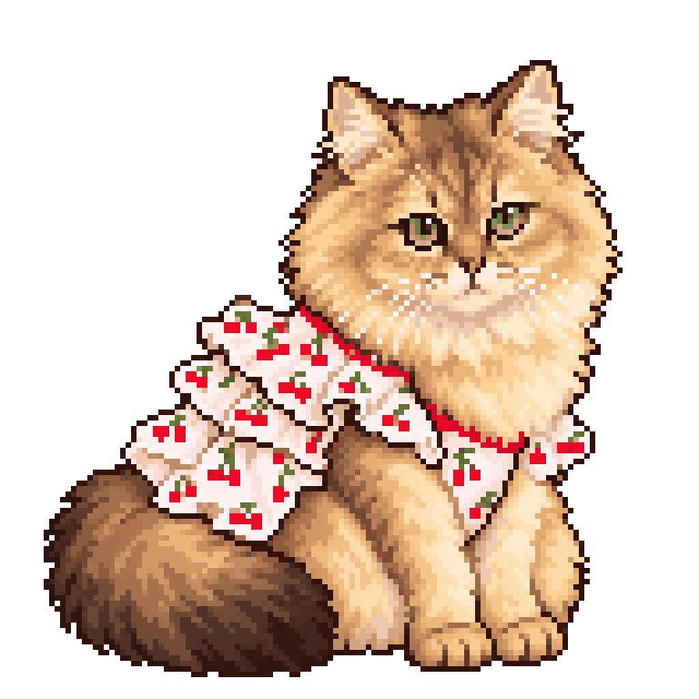
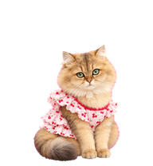
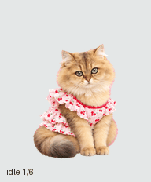
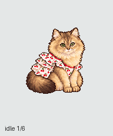
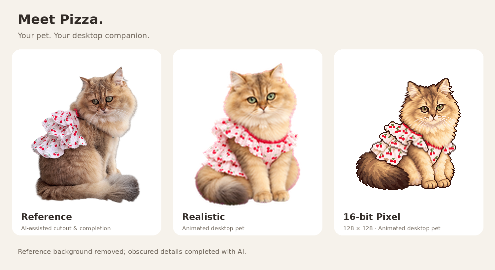

<strong>中文</strong> | <a href="README.en.md">English</a>

  

<h1 align="center">披萨</h1>

让你家的毛孩子来屏幕里监工。

想把你家的毛孩子搬进屏幕，当你的专属小监工吗？用几张照片，把它变成写实或像素模样，陪你写代码、赶作业、摸会儿鱼。没有宠物？先领一只披萨回去。

  <a href="#preview">查看两版效果</a> ·
  <a href="#create">用自己的宠物制作</a> ·
  <a href="#install">直接使用披萨</a>

## 两种模样，同一个披萨

一只是毛绒绒的写实披萨，一只是穿着同一条樱桃裙的像素披萨。看下面的动图，就知道她在屏幕里当小监工是什么样。

| 写实原版 | 16-bit 像素版 |
| :---: | :---: |
|  |  |
| 写实毛绒质感，樱桃裙 | 像素模样，同一条樱桃裙 |
|  |  |

[查看像素版原生主图](previews/pizza-pixel-native.png)

## 从宠物照片，到会动的桌面小监工

披萨是从照片里做出来的。先挑出一眼就能认出她的特征：脸型、金色长毛，还有那条樱桃裙。然后分别做出写实和像素两版，确认静态形象像她，再让她招手、跳跃。这样等到两版都动起来，也还是你熟悉的那只猫。

  

**参考照片（AI 去背景及补全）** · [查看参考图](previews/pizza-reference-ai-assisted.png)

参考照片已通过 AI 移除背景并补全遮挡细节。上图依次展示参考图、写实版和像素版。

## 用你家的宠物做一只

准备几张能看清脸型、毛色和花纹的照片。把[制作提示词](prompts/create-your-pet.md#中文)和照片一起发给 AI，告诉它哪些特征一定要保留。比如：

> 脸和耳朵要像它，尾巴上的花纹也留着。先给我看写实和像素两版长什么样，再做动作。

先确认两版主形象，再看动作预览。满意之后，拿到写实版和像素版各自的安装图，在支持 Pets v2 的环境里安装。

**[打开制作提示词](prompts/create-your-pet.md#中文)**

完整制作流程放在独立文件里，可以直接打开、复制和分享。

## 直接领一只披萨

想先体验一下？把[安装提示词](prompts/install.md#中文)交给 AI，让它先检查你当前的应用是否支持安装，再把写实版和像素版都装上。默认先让写实披萨来监工，原有宠物也保留。

**[打开安装提示词](prompts/install.md#中文)**

想换个样子时，就说「切换到像素版披萨」。
